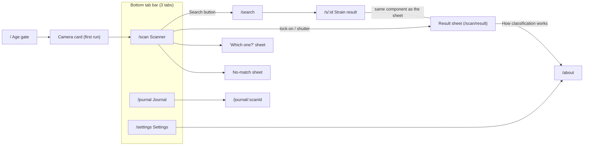
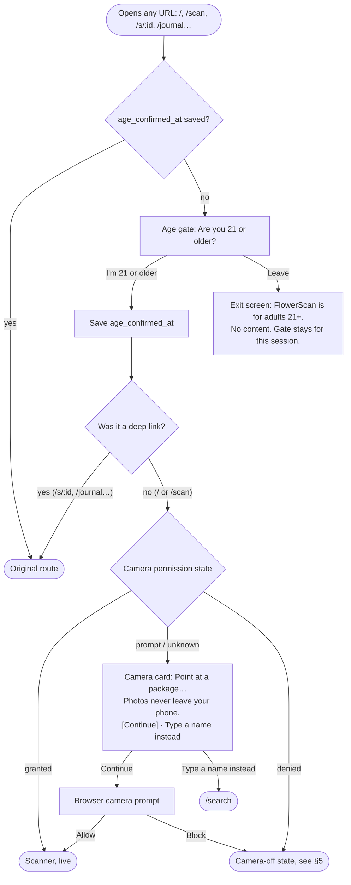
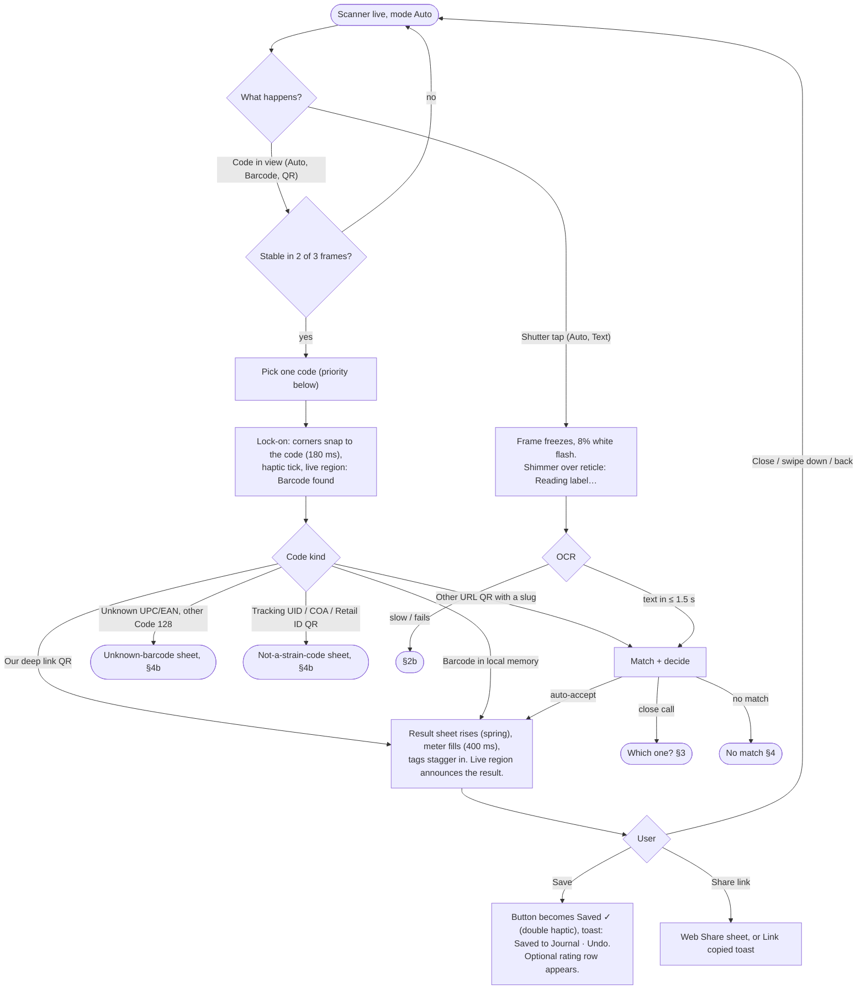
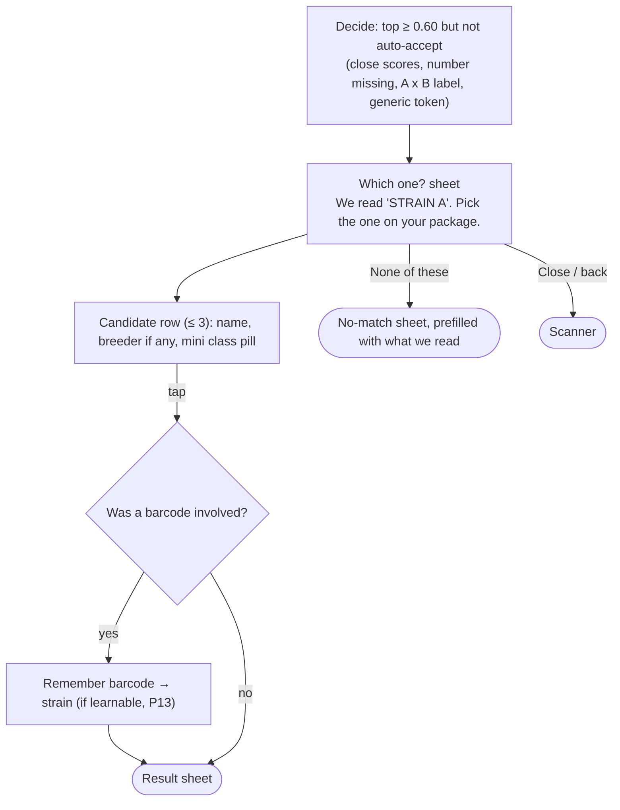
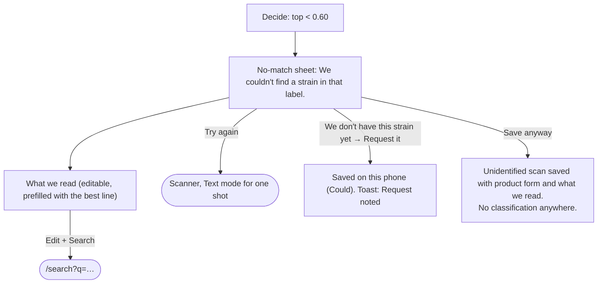
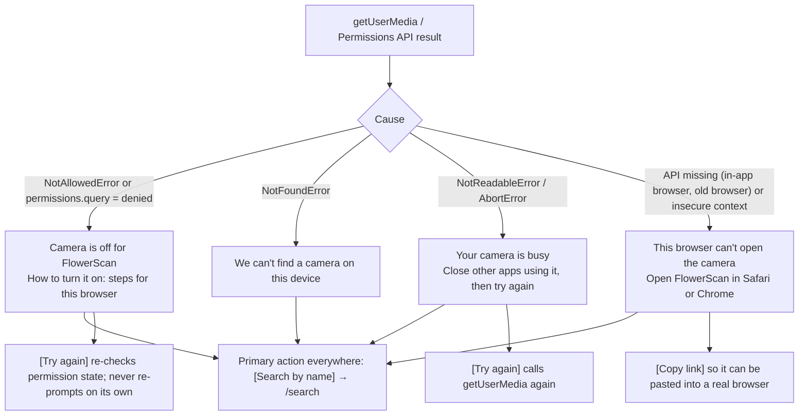
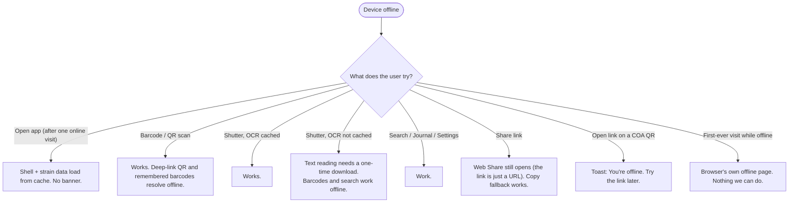
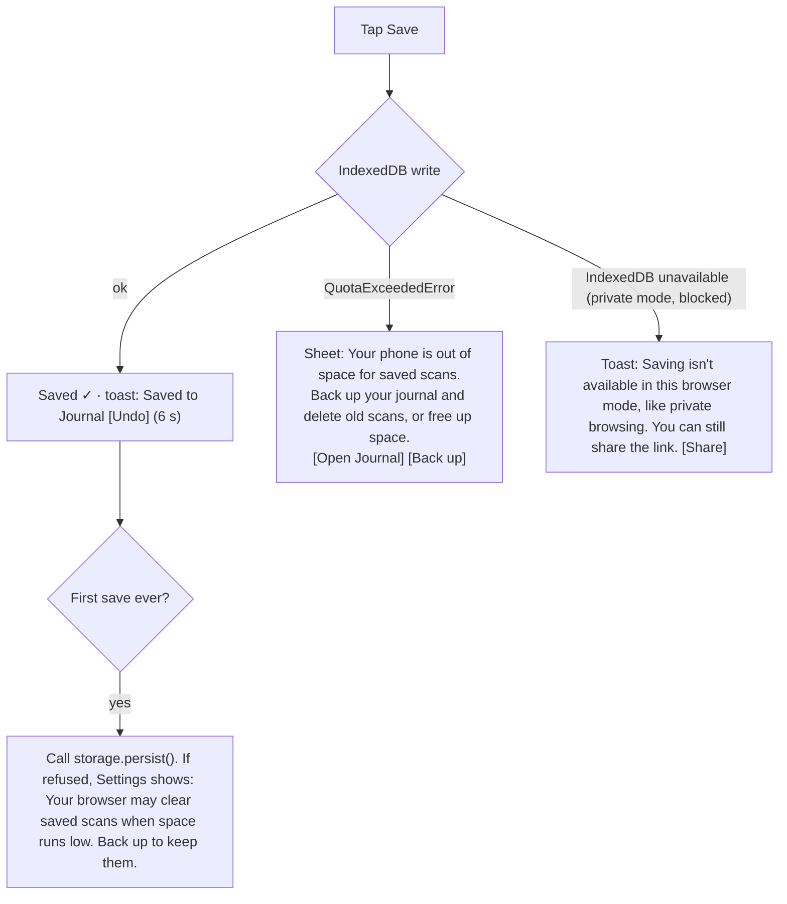
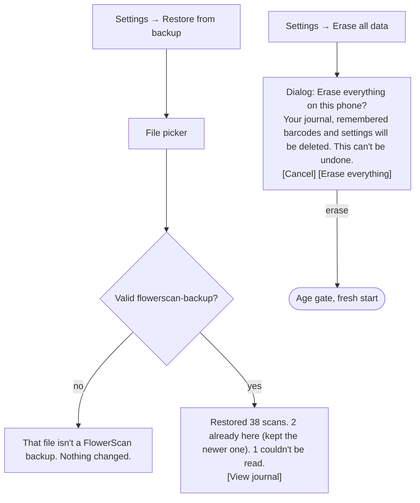

# Flows

Owner: product-designer (T-021) · Date: 2026-10-26 · Status: draft for founder review

These flows are what T-009, T-010, T-011, T-013, T-014, T-015 and T-017 build. Screen-level detail (layout,
every state, copy, accessibility) is in [screens/](screens/). The clickable version is
[mockups/index.html](mockups/index.html). Diagrams are Mermaid (GitHub and Obsidian render them).

**Words used below:** a *sheet* is a modal bottom sheet over the frozen scanner. A *screen* is a full route.
Every sheet has a close button and a tappable grabber, and browser back closes it (each sheet pushes one
history entry).

## Navigation map

- **Three tabs, labels always on** (docs/08, HIG, M3). Search is a button on the scanner, not a tab: it's a
  fallback for scanning, docs/02 requires it one tap from the scanner, and a fourth tab would split the
  "point at it" story. (HIG's new dedicated search tab was considered and rejected for that reason.)
- **About** is reached from Settings (always in the same place, SC 3.2.6) and from every result's "How we know".
- The tab bar stays visible on every top-level route. Sheets cover it while open (HIG: a modal may cover it).

## 1. First run

Decisions (docs/08 updated):
- **The intro card and the camera pre-prompt are one card.** docs/08 had three first-run steps (gate, intro,
  priming). Merging intro and priming removes a tap before the first answer, the thing the best apps optimize
  (benchmark pattern 1). The card is "skippable" through "Type a name instead".
- **Show the card once.** It's marked seen when either button is tapped (`intro_seen`, stored with settings).
  After that, if the browser forgets the permission (iOS standalone PWAs can re-ask, test-plan gap 14), the
  scanner shows a "Start camera" button instead of the card, so the browser prompt still follows a tap.
- **One primary button, "Continue", not "Allow"** (HIG Privacy). We add a secondary text link to a non-camera
  path because web.dev's permission guidance asks for one. This breaks HIG's "no escape" rule for native
  pre-alerts on purpose: a PWA user who doesn't want the camera should still get value.
- **Deep links skip the camera card.** Someone opening a shared `/s/:id` link wants that strain, not a camera.
  They meet the card the first time they open the Scan tab.
- **[Leave]** goes to an in-app exit screen with no content (not an external site, which would be a
  cross-origin navigation we don't need). For the rest of the browser session the app shows only that screen
  (`sessionStorage`); a new session asks again. Founder/legal check: Q-D1 in the screen spec.

## 2. Scan → result (happy paths)

### 2a. Several codes in view (test-plan gap 6, proposal for T-010)

Packages often carry a UPC and a QR side by side. In **Auto**, the detector collects every value that passes the
stability gate within the same 3-frame window and picks **one**, in this order:

1. Our own deep-link QR (definitive).
2. A barcode already in local barcode memory (the user confirmed it before).
3. A QR whose URL yields slug candidates.
4. An unknown UPC/EAN (leads to the unknown-barcode sheet, which offers the text scan).
5. Everything else (COA or tracking QRs, unrecognized Code 128).

The reticle locks to the winner only, so the user sees which code was used. No chooser: asking "which code?"
would be a question the user can't answer. In **Barcode** or **QR** mode, only that kind is considered.

### 2b. OCR slow or failing (test-plan gap 7)

| Time since shutter / event | What the user sees | Live region |
| --- | --- | --- |
| 0–1.5 s | Frozen frame, shimmer over the reticle, "Reading label…" | "Reading label" |
| 1.5–5 s | Same, copy changes to "Still reading. Hold on…" | — |
| 5 s | Shimmer stops (SC 2.2.2). Pill: "This is taking longer than usual." with [Keep waiting] [Search instead] | "Taking longer than usual" |
| 15 s, or the worker crashes | Error sheet: "We couldn't read that label." [Try again] (primary) [Search by name]. Tip: "Fill the frame with the strain name, and try the torch." | "Couldn't read the label" |
| First OCR use, online, data not cached | Determinate progress pill: "Getting text reading ready (one-time, 4 MB)…" then continues normally. Barcodes keep working meanwhile. | "Downloading text reading, one time" |
| Same, download fails online | "Text reading didn't download. Check your connection and try again. Barcodes and search still work." [Try again] [Search] | same text |
| Same, offline | "Text reading needs a one-time download. Barcodes and search work offline." [Search] [OK] (docs/08 copy) | same text |

The size in the download pill comes from the real asset size at build time. "4 MB" in the mockup is a sample.

## 3. Close call: "Which one?"

- The sheet **replaces its own content** with the result after a pick (one sheet at a time, HIG), and back
  returns to the list.
- Numbers are identity (P5): when candidates differ only by a number, the number is set in the display face so
  it stands out ("Strain A **#4**", "Strain A **#5**").
- An "A x B" label (P4) shows the curated cross only if it exists. Otherwise the sheet title becomes "That looks
  like a cross of two strains" and the two parents appear with the line "Parents, not a match". Picking one goes
  to that parent's **strain page** (`/s/:id`), never to a scan result, and nothing is remembered.

## 4. No match

Never show a classification, meter, tag, or "close" strain here. The editable text is the *only* thing derived
from the package.

### 4b. Barcode and QR dead ends (test-plan gap 4)

| Code | Sheet title | Body | Actions |
| --- | --- | --- | --- |
| Unknown UPC/EAN, or a Code 128 not seen before | "We don't know this barcode yet" | "Cannabis barcodes aren't in any public list, so we learn them on your phone. Scan the strain name once and we'll remember it next time." | **[Scan the label]** (Text mode, shutter pulses) · [Search by name] |
| Tracking UID (e.g. a 24-character package tag) | "That's a tracking code" | "It's unique to this one package, so it can't tell us the strain. Scan the strain name instead." | **[Scan the label]** · [Search by name] |
| COA or Retail-ID QR | "That QR is for lab results" (COA) / "That QR is a tracking code" (Retail ID) | "It doesn't name the strain. Scan the strain name instead." Shows the link's domain in plain text. | **[Scan the label]** · [Search by name] · "Open link" (opens the domain shown, in a new tab, only on tap) |

After the user picks a strain from a learnable barcode's follow-up (scan or search), the result sheet shows the
one-line note "We'll recognize this barcode next time (on this phone)."

## 5. Camera unavailable (permission denied, plus test-plan gap 1)

- All four states share one layout (the scanner area becomes a calm panel; tab bar and Search stay) and one
  primary action, **Search by name**, so a failed camera never strands anyone.
- The "turn it on" steps are browser-specific, picked by user agent, with a generic fallback (exact copy in
  [screens/scanner.md](screens/scanner.md)).
- We never call `getUserMedia` again by ourselves after a denial (web.dev). [Try again] reads
  `permissions.query` first. If it's still `denied`, it says "Still off. Change the setting, then come back."

## 6. Offline

- **No permanent offline banner.** Everything except OCR's first download and external links works offline, so a
  banner would warn about nothing (Nielsen: visibility of status, without noise). We speak up only at the
  moment something can't work.
- An app update downloaded while scanning waits. The toast "A new version is ready. [Reload]" appears only on
  the scanner's idle state or another tab, never mid-scan (X-09).

## 7. Save, journal, and storage (test-plan gap 8)

- Rating and notes save automatically on change (no Save button on the detail screen). The status line reads
  "Saved" after each write, announced politely.
- Delete is on the detail screen only, with an Undo toast (no swipe-to-delete, so there's no drag-only action,
  SC 2.5.7).

## 8. Restore and erase

Counts in the restore summary come from the real merge result. The numbers above are examples.
